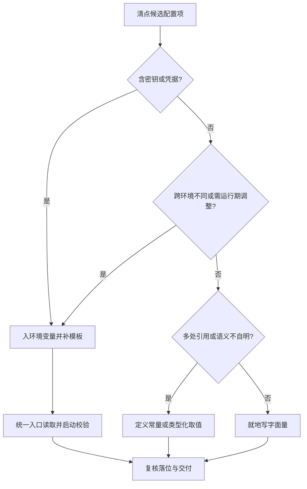

# 服务端配置放置规则

按下图推进，逐节点落实其细则。

## 配置分流流程



## S1 配置项清点

1. S1：动笔前把本次涉及的可变值列成清单，逐项走完 D1 到 D3 再写实现；禁止边写实现边决定放置位置。

2. S1：清点范围覆盖外部服务地址与端点、凭据、超时、重试次数、并发与批量大小、文件与目录路径、功能开关、业务阈值、格式与编码、状态取值集合。

3. S1：动笔前从 `internal/config/`、`configs/.env.example` 与 `README.md` 确认项目已在用的配置方式，本次一律沿用环境变量加 `caarlos0/env` 结构体解析。

4. S1：新增配置项按现有 `env` 与 `envDefault` tag 语法写入 `internal/config/config.go`，同步补 `configs/.env.example`；禁止另建 YAML、TOML 或 INI 配置文件。

5. S1：仓库同时存在多种配置来源、无法判断哪一份生效、或读取入口找不到时，先向用户确认目标位置与格式，得到答复前禁止新建或改写任何配置文件。

## D1-S2 密钥与凭据

6. D1：口令、令牌、API Key、私钥、证书口令、含账号密码的连接串一律判为凭据，只写入环境变量或本地 `configs/.env` 并由 `config.Load()` 读取。

7. S2：凭据禁止出现在会提交进版本库的任何文件里；模板文件只允许保留本地占位凭据或空值，提交的配置文件只保留不含真实凭据的部分。

8. S2：新增凭据键时同步在 `configs/.env.example` 补同名键、占位值和一行用途注释，并确认 `.gitignore` 已忽略 `configs/.env`。

9. S2：各部署环境的环境变量由部署流程单独注入，禁止随代码仓库与镜像分发。

10. S2：凭据只在配置入口处读取，禁止打印、写日志、拼进异常信息和错误响应；`DATABASE_URL` 等含口令的值禁止整体输出。

## D2-S2 环境变量配置

11. D2：只有取值在开发、测试、生产之间不同，或已有明确的运维、灰度、业务诉求要求不改代码就能调整时，才判为环境变量配置项。

12. D2：判定依据只取已经存在的诉求；禁止以「将来可能要改」「做成可配置更灵活」为由把值放进环境变量。

13. S2：全量环境取值相同且从未被调整过的值禁止进环境变量，改为常量或字面量。

14. S2：程序内部结构禁止进环境变量，包括字段映射表、状态取值集合、SQL 片段、路由路径、提示词与模板文本、错误码文案；这些随代码一起变更，用常量或类型化取值承载。

15. S2：控制分支走向的开关只在需要按环境或灰度切换时才进环境变量；仅为兼容旧逻辑保留的开关直接删除对应分支。

16. S2：配置项按业务域分组命名，键名用 `UPPER_SNAKE_CASE`；时间值必须用 `time.Duration` 可解析的写法（如 `5s`），禁止裸数字秒数。

17. S2：环境差异用部署环境注入的不同变量值表达；禁止在代码中写按环境判断的配置分支，`APP_ENV` 只用于选择日志格式这类已确认的差异。

18. S2：配置项的值只用标量、列表和简单映射；禁止写入表达式、Go 类型路径和可执行片段。

    > 反例：`HANDLER: "internal/adapter/http:NotebookHandler"`，由配置动态导入实现类型。
    > 正例：用环境变量只表达端点、超时与开关，实现类型由组合根在代码中选择。

## D3-S4-S5 常量与字面量

19. D3：同一值在两处及以上出现，或单看字面量无法判断含义时，定义为具名常量。

20. D3：值只在一个函数内出现且含义由上下文自明时直接写字面量；禁止为它新建常量。

    > 正例：`chunk = data[:2]`、`megabytes := size / 1024 / 1024`。

21. D3：字面量出现在条件判断或分支阈值中且含义不自明时，即使只有一处也提为常量。

    > 反例：`if code == 4029 { ... }`；正例：`if code == rateLimitErrorCode { ... }`。

22. S4：常量就近定义在使用它的包内；两个及以上包共用时才上提到该包或 `internal/platform/` 下的常量文件，禁止建一个收纳全项目常量的全局文件。

23. S4：一组互斥取值用自定义类型加常量定义，禁止用并列的裸字符串或整数表达同一集合。

    > 示例：
    >
    > ```go
    > type TaskStatus string
    >
    > const (
    >     TaskStatusPending TaskStatus = "pending"
    >     TaskStatusDone    TaskStatus = "done"
    > )
    > ```

24. S4：常量名用 `MixedCaps` 并带单位或量纲后缀；导出常量首字母大写，只在包内使用的常量首字母小写。

    > 示例：`RequestTimeout = 10` 禁止；`RequestTimeoutSeconds = 10` 用。

25. S4：常量只放不可变字面值、切片字面量与基本类型转换；需要运行期求值或依赖外部状态的值放配置结构体或函数，禁止在包初始化期执行 I/O。

## S6 读取与校验

26. S6：环境变量与 `configs/.env` 只由 `internal/config/config.go` 的 `config.Load()` 统一加载为 `Config` 结构体，业务代码只接收该结构体；禁止在业务包中调用 `os.Getenv`。

    > 示例：
    >
    > ```go
    > timeout := os.Getenv("HTTP_REQUEST_TIMEOUT")   // 禁止
    > timeout := cfg.HTTPRequestTimeout              // 用
    > ```

27. S6：配置项的取值来源固定为环境变量；`configs/.env` 只作为本地开发便利，缺失时视为正常，生产环境直接使用真实环境变量。

28. S6：每个配置项在 `Config` 结构体中声明 Go 类型与 `envDefault` 默认值，由 `caarlos0/env` 完成类型转换与取值校验。

29. S6：必填且无合理默认的配置项在 `config.Load()` 中校验，缺失或非法直接返回错误并终止启动；禁止延迟到首次调用才暴露，禁止静默回退到内置默认值。

30. S6：`Config` 在组合根构造一次并显式传入需要它的组件；禁止在函数内部随取随读，禁止运行期修改配置结构体。

31. S6：启动时记录生效配置只输出非敏感项，凭据类字段一律脱敏或省略。

## S7 复核与交付

32. S7：复核每个候选项恰好落在一层，且旧位置的定义、读取代码和模板条目已同步删除。

33. S7：复核常量作用域，只被一个包使用的常量从共享常量文件下沉回该包。

34. S7：交付说明列出本次新增或改动的配置项、所在层级、默认值，以及需要在部署环境补齐的变量键。

## 全局约束

35. 判定卡在环境变量与常量之间时按常量落地，并在交付说明中标注该项；禁止以拿不准为由默认放进环境变量。

36. 环境变量键名用 `UPPER_SNAKE_CASE`，`Config` 字段名用 `MixedCaps`，两者通过 `env` tag 一一对应；禁止在代码中硬编码同一键名的字符串。

37. 只调整本次需求涉及的配置项；禁止顺带迁移、重命名或重排既有配置。
