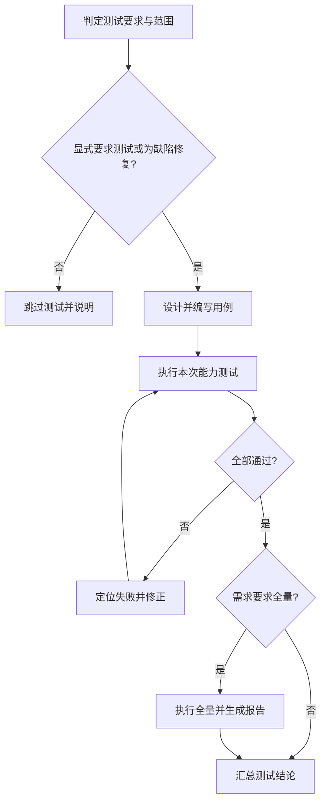

# Go 测试规则

按下图推进，逐节点落实其细则。

## 测试流程



## S1 触发判定与范围

1. S1：需求文本出现「测试」「单测」「单元测试」「接口测试」「集成测试」「用例」「`go test`」「验证」「覆盖」任一词时，判定为要求测试。

2. S1：需求为修复缺陷、报错或异常行为时，即便未出现上述词也判定为要求测试，并必须包含一条在旧实现上稳定复现该缺陷的回归用例。

3. S2：规则 1 与规则 2 的判定都不成立时只交付生产代码，在交付说明中写一句「本次未编写测试」，禁止顺带新增或修改任何测试文件与测试配置。

4. S1：测试范围只覆盖本次变更触及的公开入口，禁止为未改动的包补测试。

5. S1：项目已有同目录 `*_test.go` 布局、外部测试包与 `make test`、`make test-integration` 命令时一律沿用，禁止搬迁既有结构或另建 `tests/` 目录。

## S3 用例设计与编写

6. S3：按本次变更的最高公开入口选层级；改动独立工具或纯函数时写单元测试；改动 usecase 业务规则时写 usecase 测试；改动 HTTP handler 时写接口测试并覆盖错误映射；改动 Repository 或 SQL 时写 PostgreSQL 集成测试。

7. S3：测试文件与被测包放在同一目录，文件名用 `<被测文件>_test.go`；禁止把所有测试集中到独立目录。

8. S3：黑盒测试用 `_test` 外部包（如 `usecase_test`），需要访问未导出标识符时才用同包测试；同一文件只选一种测试包。

9. S3：只从公开入口调用被测对象；禁止为覆盖率直接调用未导出实现。

10. S3：每个被测公开能力至少覆盖一个正常场景、一个异常场景、一个有业务意义的边界场景。

11. S3：新增 HTTP 接口至少覆盖成功响应、请求校验或业务错误响应、一条从路由到 usecase 的真实接线用例。

12. S3：错误场景必须断言确定的错误类型、`errors.Is` 结果、HTTP 状态码或响应体字段。

    > 示例：
    >
    > ```go
    > if rec.Code != http.StatusUnprocessableEntity {        // 用
    >     t.Fatalf("status = %d", rec.Code)
    > }
    > if rec.Code == http.StatusOK { t.Fatal("unexpected") } // 禁止：只断言非 200
    > ```

13. S3：多组等价输入用表驱动测试加 `t.Run`，禁止复制粘贴同构用例。

14. S3：子测试名用 `t.Run("返回校验错误", ...)` 描述可观察行为；禁止 `case1`、`case2` 这类名称。

15. S3：测试辅助函数以 `t *testing.T` 为第一个参数并调用 `t.Helper()`；禁止在辅助函数中直接 `os.Exit` 或吞掉失败。

16. S3：资源清理用 `t.Cleanup`；测试创建的文件、连接池与数据库记录必须在用例结束前释放或回滚。

17. S3：HTTP 测试用 `httptest.NewRequest` 与 `httptest.NewRecorder` 直接调用 `http.Handler`，禁止启动真实端口或依赖固定端口。

18. S3：Repository 单元测试用实现领域接口的 fake；禁止用反射或 Mock 框架伪造 sqlc 生成代码。

19. S3：PostgreSQL 集成测试读取 `TEST_DATABASE_URL`，未设置时调用 `t.Skip`；禁止连接生产数据库或把连接串写进测试文件。

20. S3：集成测试必须自行执行迁移并清理测试数据，用例之间不得依赖执行顺序。

21. S3：第三方 API、消息队列与对象存储一律用 fake 替换；确需真实调用时给该用例启用单独的环境变量开关，并在报告中列为未覆盖范围。

22. S3：涉及并发、共享状态或 `t.Parallel` 的用例必须能通过 `go test -race`；共享数据库或环境变量的用例禁止标记 `t.Parallel`。

23. S3：测试依赖只用标准库 `testing`、`net/http/httptest`、`errors` 与 `context`；禁止引入 `testify`、`gomock`、`httpexpect`，用户明确要求时除外。

## S4 执行与失败处理

24. S4：新写或修改单个用例时只运行该用例，例如 `go test ./internal/usecase -run TestCreateNotebook`。

25. S4：当前能力写完后运行其所属包的测试；接口与 usecase 同时变化时分别运行 `./internal/adapter/http` 与 `./internal/usecase`。

26. S4：项目提供 `make test` 与 `make test-integration` 时优先使用；禁止使用项目未定义的测试命令或脚本。

27. D2：存在失败或错误用例时一律进入 S5，禁止在未全绿时汇总结论或执行全量。

28. S5：先把失败归因为测试代码错误、测试环境问题、既有无关失败、本次生产缺陷四者之一，再动手修改。

29. S5：原需求包含实现或修复授权时才可改生产代码；需求只要求测试时，发现生产缺陷先报告，禁止静默修复。

30. S5：禁止删除用例、追加 `t.Skip`、弱化断言或扩大 fake 范围来换取通过。

31. S5：每次修正后先重跑失败用例，通过后再跑对应包；无法解决时保留失败输出，说明阻塞原因、影响范围与下一步动作，禁止把未解决的失败描述为通过。

## S6 全量与报告

32. D3：需求文本出现「全量」「回归」「全部测试」「整体测试」「跑一遍所有」任一词时才执行全量，否则直接进入 S7。

    > 反例：因为改动看起来影响面大就自行升级为全量；范围只由需求文本决定。

33. S6：全量执行用 `go test ./...`；集成测试用 `TEST_DATABASE_URL=... go test ./internal/adapter/postgres/...` 单独执行，并在报告中列为独立范围。

34. S6：全量执行后在 `hiduck/doc/test-report-YYYYMMDD-HHMMSS.md` 写报告，内容依次为执行时间与命令、Go 版本与 Commit、通过与失败与跳过数与耗时、实际测试范围、失败用例及原因、未覆盖范围、风险与后续动作。

35. S6：报告的描述、结论、风险与后续动作用中文，命令、包路径、测试名、错误名、状态码、依赖名保留英文。

36. S6：本地全量确实不可行时执行受影响测试集，并在报告与交付说明中写明「本地未执行全量测试」，禁止写「全部测试通过」。

## 全局约束

37. S7：未经过 S6 时禁止生成任何报告文件，结论只写在交付说明中。

38. 只编写测试代码与必要的测试配置；禁止借测试之名重构与本次变更无关的生产代码。

39. 禁止把测试扩大到性能、压力、安全、前端 E2E 或真实第三方集成。

40. 测试中发现的生产缺陷按规则 29 与规则 31 处理；禁止在测试任务中顺带修改业务行为。

41. 交付说明写明新增或修改了哪些测试文件、实际执行的命令与结果、是否执行全量及报告路径、测试暴露并处理了哪些问题、遗留的失败与跳过。
