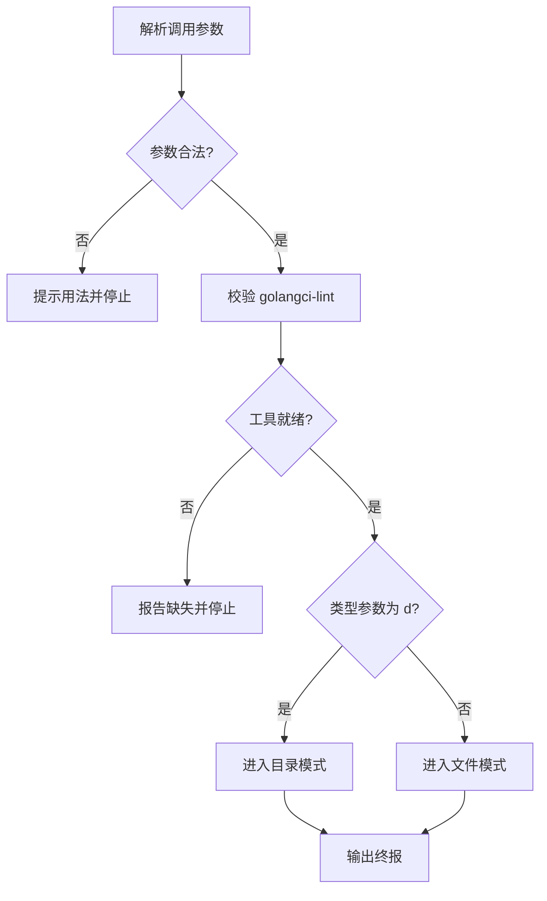
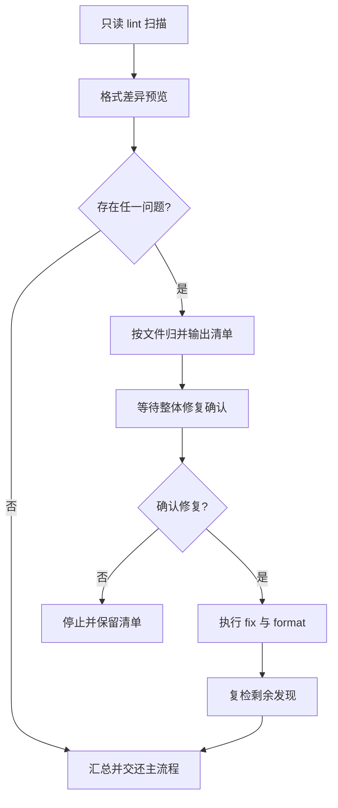
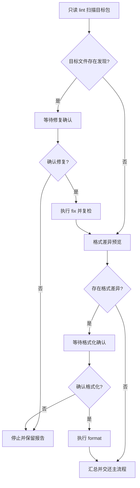

# golangci-lint 检查与格式化

按下图推进，逐节点落实其细则。

## 调用流程

## S1 参数解析

1. S1：调用格式固定为 `<类型> <相对路径>` 两个参数，类型只接受 `d` 与 `f`，`d` 后跟目录，`f` 后跟文件。

2. D1：参数个数不为二、类型不是 `d` 或 `f`、类型与路径实际种类不符时，输出一行用法并停止，禁止推断用户意图。

   > 示例：`用法：$golangci-lint-check-format d <相对目录> | f <相对文件>`

3. S1：把工具工作目录视为项目根，除非用户在调用中显式给出其他项目根。

4. S1：只接受项目根内的相对路径；绝对路径、空路径、含 `..` 的路径以及逃出项目根的路径一律拒绝并停止。

5. S1：目标不存在时报告解析出的实际路径并停止，禁止改用邻近路径重试。

## S3 环境校验

6. S3：`golangci-lint` 一律使用项目根可执行文件，配置固定为项目根 `.golangci.yml`。

7. S3：进入后续节点前先运行 `golangci-lint --version` 确认可执行文件可用并记录版本。

8. D2：`golangci-lint` 不存在时报告 `当前环境未安装 golangci-lint，已停止，未执行任何自动安装。` 并停止。

9. D2：`.golangci.yml` 不存在或无法解析时报告配置缺失并停止；禁止改用默认配置继续扫描。

10. S3：禁止运行 `go install`、`brew install`、`go run` 或任何会修改工具链与项目依赖的安装命令。

## S5 目录模式

11. S8：运行 `golangci-lint run ./<相对目录>/...` 全量扫描；退出码非零但带有发现时视为有效输出，不当作命令失败。

12. S9：运行 `golangci-lint fmt --diff ./<相对目录>/...` 只预览格式差异，本节点禁止写入文件。

13. S10：清单按文件归并，每个文件给出 lint 发现数、其中可自动修复数、是否存在格式差异；涉及文件超过 20 个时只列前 20 个并附总数。

14. S10：清单禁止粘贴完整 diff 与完整 linter 输出；仅当单个文件的 diff 短于 20 行时可一并附上。

15. D5：目录模式只设这一道门控，确认一次即覆盖 lint 修复与格式化，中途不再追加询问。

16. S13：先运行 `golangci-lint run --fix ./<相对目录>/...`，再运行 `golangci-lint fmt ./<相对目录>/...`，顺序不可颠倒。

17. S14：复检重跑只读 `golangci-lint run ./<相对目录>/...`，报告剩余发现与实际被格式化的文件数。

18. S12：用户拒绝时不执行任何写入命令，原样保留清单供下次调用。

## S6 文件模式

19. S16：运行 `golangci-lint run <相对文件>` 只读扫描；当前版本不支持单文件参数时改用 `golangci-lint run ./<文件所在目录>` 并按 `file:line` 过滤出目标文件的发现；禁止把同包其他文件的发现计入清单。

20. S19：确认后运行 `golangci-lint run --fix <相对文件>`；当前版本只能按包修复时改在以 `<相对文件>` 所在目录为目标执行，并在修复前记录 `git status --short`，修复后核对改动文件列表，出现目标文件之外的新改动时停止并报告，禁止擅自保留或还原。

21. S20：运行 `golangci-lint fmt --diff <相对文件>`；diff 为空时报告未发现 format 变更。

22. S22：确认后运行 `golangci-lint fmt <相对文件>`，并报告本次改动范围。

23. S18：文件模式两道门控中任意一道被拒绝，立即终止整个流程，不再进入后续节点。

24. S16：同包其他文件出现可自动修复的发现时，禁止顺带修复；只报告目标文件的范围，并在终报中提示同包存在其他发现。

## 全局约束

25. 确认必须是显式表述，如 `确认 fix`、`执行 fix`、`修复`、`确认 format`、`格式化落地` 或语义同样明确的说法；沉默、含糊同意、要求"再看细节"一律不作数。

26. 用户表示停止、暂停、取消、否定，或只要求查看报告时，禁止执行任何写入文件的命令。

27. 作用范围严格限定为参数给定的文件或目录；用户未明确扩大范围时，禁止波及父目录、同级包或整个项目。

28. 目录模式递归处理子目录，并沿用 `.golangci.yml` 中的 `exclusions` 规则；禁止自行增删排除项。

29. 遵循项目现有 `.golangci.yml`；禁止自行追加 `--enable`、`--disable`、`--config`、`--new`、`--new-from-rev` 等选项，用户明确要求时除外。

30. 修复与格式化只允许修改参数给定的文件；出现目标之外的改动时停止并报告，由用户决定后续处理。

31. 报告依次给出：项目根、模式与目标、工具版本、lint 发现或 `未发现 lint 问题`、format 差异摘要或 `未发现 format 问题`、下一步需要用户做的决定。

32. 报告只写事实与待决动作；禁止转述命令输出全文、解释 linter 规则含义或评价代码风格。
