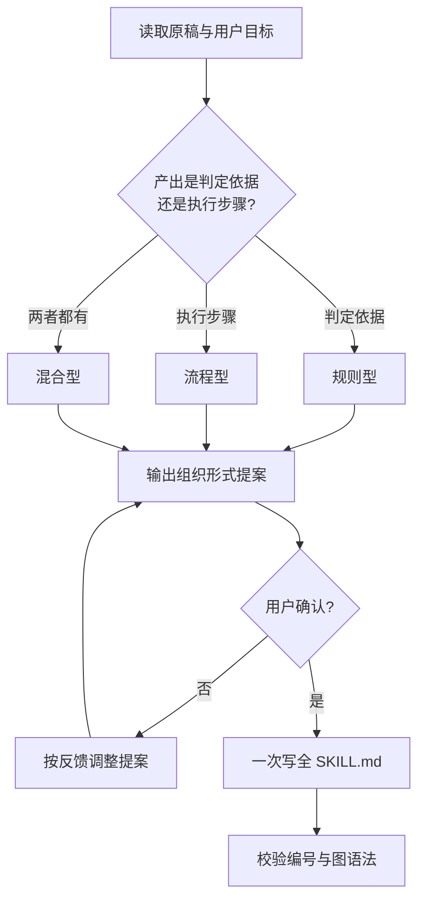

# 基本能力
@hiduck/general-rule/chinese-output.md
@hiduck/general-rule/minimal-design.md
<!-- @hiduck/general-rule/project-folder-responsibility-description.md -->
@hiduck/general-rule/response-style.md

# skill编写规则
## 编写流程



4. S1：动笔前读原稿、用户目标和同类已重构 skill，确认本次的约束对象与使用场景。
5. S2：收到新建或重构 skill 的请求后，先输出组织形式提案；用户确认前禁止写入任何文件。
6. S2：提案必须包含判定出的类型及一句依据、章节骨架、预计规则条数；流程型与混合型追加流程图节点草稿。
7. S2：提案控制在一屏内，禁止提前展开规则正文。
8. D2：用户提出修改时，改完重新确认，禁止边确认边写。
9. S4：确认后一次写全整篇，禁止增量拼接。
10. S5：落地后校验编号连续性、引用块缩进和 mermaid 语法。

## 类型判定

11. 产出为无固定执行顺序的约束集合、模型逐条比对代码或方案时，判为规则型。

    > 示例：`go-coding-rules`。

12. 产出为有先后依赖的执行步骤、模型按阶段推进任务时，判为流程型。

    > 示例：需求调研、发布上线、故障排查。

13. 既有阶段先后、每个阶段又带硬约束时，判为混合型。

    > 示例：数据库表设计（先建模流程，再字段与索引规则）。

14. 判不准时按混合型处理；禁止用编号规则的先后顺序隐式表达流程。

## 元信息

15. `description` 只写"何时触发"，不写"这是什么"；它是模型选取技能的唯一依据。
16. `description` 覆盖动作词和对象范围，不堆形容词。

    > 示例：
    > ```yaml
    > description: 提升代码可读性、可维护性、类型安全的专业指导       # 禁止：无触发信号
    > description: 编写、修改、重构或审查 Python 源代码时遵守的强制规则  # 用
    > ```

17. 正文开头一句话声明执行方式，不写愿景和背景。

    > 示例：规则型用 `以下规则为强制约束，逐条执行。`；流程型用 `按下图推进，逐节点落实其细则。`

## 规则写法

18. 约束部分全部为编号规则，禁止散文段落。
19. 编号在整篇内连续，跨小节不重置，保证"规则 14"可被稳定引用。
20. 一条规则一句祈使句，谓语用「用 / 必须 / 只用 / 只允许 / 禁止」。
21. 触发条件写进规则句本身，让每条能独立判定，不依赖上下文。

    > 示例：
    > ```text
    > 优先使用实例方法。                           # 禁止：无判据，无法判定
    > 行为依赖可变状态、配置或协作者时，用实例方法。   # 用：条件 + 动作
    > ```

22. 禁止写理由、背景、权衡和论证过程；结论直接作为规则。
23. 每个禁止项必须同时给出替代方案。

    > 示例：`禁止 Java 风格 getter/setter；需要校验或计算时用 property。`

24. 同一约束只在一处出现；发现重复就合并到语义最贴切的那条。
25. 能收敛为单一路径的决策不留分支，宁可限制自由度也要保证风格一致。

    > 示例：`纯数据结构只用 dataclass` 优于 `可用 dataclass、NamedTuple、TypedDict 或现有模型`。

26. 确需分支时，在一条规则内用分号并列各分支及其判据，不拆成多条。
27. 术语、类型、标识符、装饰器一律用反引号包裹。
28. 用二级标题分组规则，组名指向约束领域，不指向抽象概念。

    > 示例：`## 异常与失败` 优于 `## 健壮性设计`。

## 流程写法

29. 流程一律用 mermaid 图表达；禁止用嵌套列表、缩进层级或散文描述步骤先后。
30. 图类型按场景选：线性或带分支的执行步骤用 `flowchart TD`；多角色、跨系统的消息往来用 `sequenceDiagram`；对象在有限状态间迁移用 `stateDiagram-v2`。
31. `flowchart` 节点 ID 用 `S` 加数字表示动作、`D` 加数字表示判定，按执行顺序递增，供规则条目引用。

    > 示例：
    > ```mermaid
    > flowchart TD
    >     S1[拉取表结构] --> D1{存在外键环?}
    >     D1 -->|是| S2[拆分关联表]
    >     D1 -->|否| S3[生成迁移脚本]
    > ```

32. 节点文本用祈使短句且不超过 15 字，禁止写理由、代码和条件表达式。
33. 判定节点用 `{}` 菱形，每条出边必须标注判定结果。
34. 单张图节点不超过 12 个；超出时把子过程收成一个节点，另起一张子流程图。
35. 每条路径必须收敛到终止节点，禁止悬空分支。
36. 失败、回退和用户拒绝路径必须在图中显式画出，禁止只画理想路径。
37. 图后用编号规则补充节点细则，规则句首标注对应节点 ID。

    > 示例：`S2：拆分关联表时保留原表主键，禁止改动既有列名。`

38. 节点细则只写图承载不了的约束（输入、产出物、判定阈值），禁止复述节点文本。

## 混合型组织

39. 混合型正文顺序固定：主流程图 → 阶段细则 → 全局规则。
40. 阶段细则按流程节点分组，二级标题带节点 ID。

    > 示例：`## S3 字段建模`。

41. 全局规则放在最后一节，只收录跨阶段生效的约束。

## 示例写法

42. 仅当文字描述会产生歧义时才补示例；描述已充分的规则不加。
43. 示例用 `>` 引用块挂在所属规则下方，缩进对齐该列表项的内容起始列。

    > 说明：个位数编号缩进 3 空格，两位数编号缩进 4 空格，否则引用块会打断列表编号。

44. 示例控制在 6 行内，只保留能区分对错的最小片段。
45. 对比型示例用 `# 禁止` 与 `# 用` 并排同一代码块，不拆成两块。

    > 示例：
    > ```python
    > def set_mode(mode: Any) -> None: ...                         # 禁止
    > def set_mode(mode: Literal["fast", "accurate"]) -> None: ... # 用
    > ```

46. 无需代码的场景用 `> 反例：…` / `> 正例：…` 单行说明。

## 精简

47. 删除"完成前自检清单"；它是规则的复述，只会稀释信号。
48. 删除"本技能不负责 X"的职责边界条款；由注入时机控制，不靠文档防御。
49. 删除铺垫性开场、章节导语和总结段。
50. 不为假想场景预写规则；先覆盖真实任务，缺失项等出现后再补。

## 修改纪律

51. 收紧某条规则后，必须检索全文，同步修正与之冲突的其他规则。

    > 示例：禁用 `Protocol` 后，同步从 typing 导入白名单和其他规则的表述中移除 `Protocol`。

52. 改动流程图后，必须同步更新引用了相关节点 ID 的规则条目。
53. 只重构用户指定的 skill，不顺带改动其他 skill。