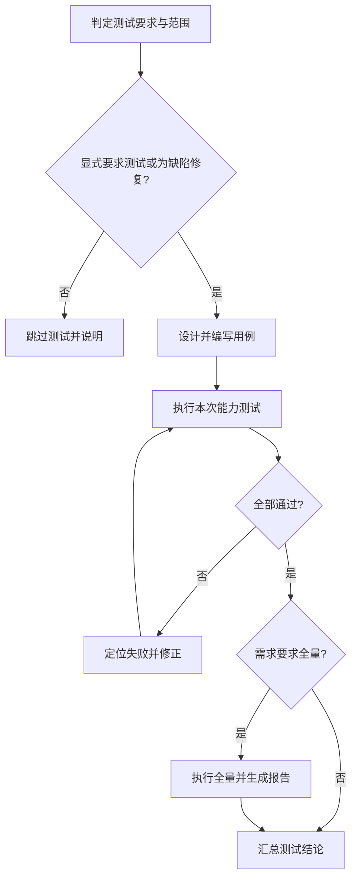
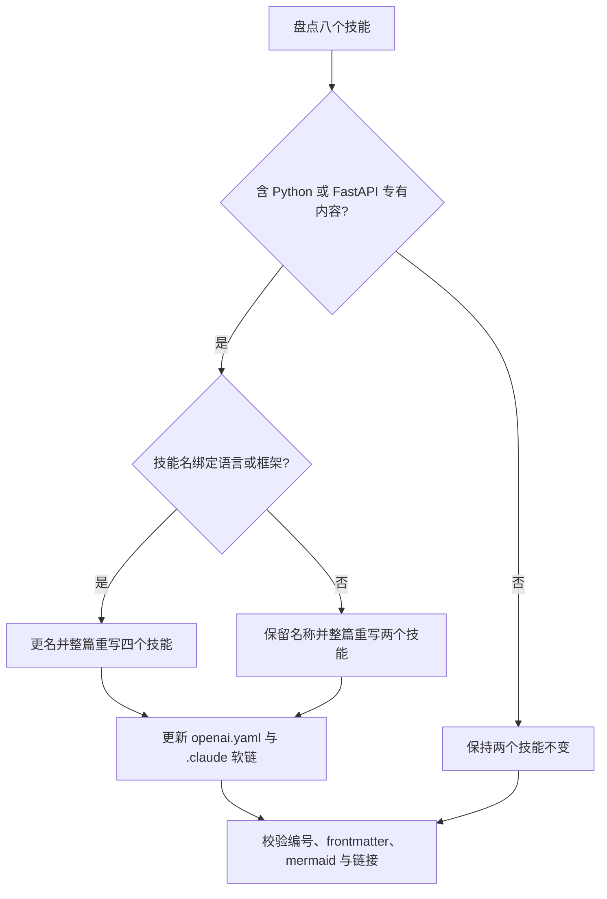

# Go 技术栈技能改写

## 目标与范围

把 [.agents/skills](../../.agents/skills) 中依赖 Python/FastAPI 的技能，改写成当前仓库实际使用的 Go 技术栈版本，并让改写后的技能符合 [AGENTS.md](../../AGENTS.md) 中的 skill 编写规则。

技术栈以 [go.mod](../../go.mod)、[README.md](../../README.md) 与 [go-web-research-plan.md](../../go-web-research-plan.md) 为准：Go 1.27、`net/http` + `go-chi/chi v5`、`jackc/pgx v5`、`sqlc`、`pressly/goose`、`caarlos0/env`、`log/slog`、`go-playground/validator v10`、`golangci-lint`、`air`。

目录标准参照 [`golang-standards/project-layout`](https://github.com/golang-standards/project-layout)，只取当前项目实际使用或明确需要的目录：`cmd/`、`internal/`、`api/`、`configs/`、`scripts/`。该 README 已声明自己不是 Go 官方标准，因此不引入 `pkg/`、`src/`，也不预建 `build/`、`deployments/`、`test/`、`tools/`、`examples/`、`third_party/`、`assets/`、`web/` 等当前未使用的目录。`db/` 是项目现有的扩展约定，继续保留。

本次只改技能文档、配套 `agents/openai.yaml`、`.claude/skills` 软链，以及 AGENTS.md 中引用旧技能名的示例；不改 Go 源码，不改 `hiduck/general-rule/` 下的 FastAPI 与 Alembic 规则文件。

## 现状与关键决策

### 技能盘点

| 技能 | 现状 | 本次处理 | 目标名称 |
| --- | --- | --- | --- |
| `python-coding-rules` | 64 条 Python 规则，覆盖 3.10 语法、Pydantic、`typing`、`ABC` | 改名并整篇重写 | `go-coding-rules` |
| `fastapi-project-rules` | 65 条 FastAPI 分层规则，含 `Depends`、`AsyncSession`、`app.state` | 改名并整篇重写 | `go-web-project-rules` |
| `pytest-test-rules` | 46 条 pytest 流程规则，含 `pytest-asyncio`、`TestClient` | 改名并整篇重写 | `go-test-rules` |
| `ruff-check-format` | 31 条 Ruff/uv 流程规则，依赖 `.venv` | 改名并整篇重写 | `golangci-lint-check-format` |
| `config-placement-rules` | 38 条配置分流规则，示例绑定 `os.getenv`、`BaseSettings` | 保留名称，整篇改写 | `config-placement-rules` |
| `db-table-design-rules` | 47 条建表规则，示例绑定 SQLAlchemy、Alembic、ORM 关系导航 | 保留名称，整篇改写 | `db-table-design-rules` |
| `git-commit-message` | 只依赖 git，无语言或框架绑定 | 保持不变 | `git-commit-message` |
| `plan-before-action` | 只依赖计划文档流程，无语言绑定 | 保持不变 | `plan-before-action` |

### 关键决策

- 四个名称直接绑定 Python 或 FastAPI 的技能改为 Go 名称，避免描述与目录名继续误导技能选择；不保留 Python 版本。
- `config-placement-rules` 与 `db-table-design-rules` 的名称本身与技术栈无关，保留目录名，只替换流程图节点措辞、示例与工具约束。
- `git-commit-message` 与 `plan-before-action` 不涉及语言技术栈，本次不动。
- 所有改写后的技能继续遵守 AGENTS.md 的规则写法：编号全篇连续、一条规则一个判据、禁止与替代方案成对出现、示例只在有歧义时补。
- `hiduck/general-rule/project-folder-responsibility-description.md` 与 `new_rule.md` 仍是 FastAPI 与 Alembic 规则，且未被 AGENTS.md 实际引用；它们不在 `.agents/skills` 范围内，本次不处理。

### 参照标准

- 布局：[`golang-standards/project-layout`](https://github.com/golang-standards/project-layout)，只取 `cmd/`、`internal/`、`api/`、`configs/`、`scripts/` 等已使用目录。
- 官方布局说明：[Organizing a Go module](https://go.dev/doc/modules/layout)，`cmd/` 放命令入口，`internal/` 放不可被外部导入的包。
- 编码约定：Go 官方 Effective Go、Go Code Review Comments 与标准库现有用法。
- 项目事实：[.golangci.yml](../../.golangci.yml) 的 depguard 分层规则、[sqlc.yaml](../../sqlc.yaml)、[Makefile](../../Makefile)、[db/migrations](../../db/migrations)、[db/queries](../../db/queries)、[internal](../../internal) 现有分层。
- 文档规范：[AGENTS.md](../../AGENTS.md) 的 skill 编写规则。

## 各技能改写方案

### go-coding-rules（规则型，约 61 条）

类型判定：产出是无固定执行顺序的约束集合，模型逐条比对 Go 源码，判为规则型。

章节骨架与预计条数：

| 章节 | 条数 | 约束范围 |
| --- | --- | --- |
| 语言版本与工具链 | 3 | Go 1.27、`go.mod`、禁止旧版本兼容分支 |
| 语法克制 | 5 | 禁止反射建类型、`unsafe`、`init()` 副作用、过度嵌套表达式 |
| 代码组织 | 8 | 包职责、构造函数注入、消费方定义接口、禁止万能 `utils` 包 |
| 命名 | 8 | `MixedCaps`、首字母缩写、`ErrXxx`、接口 `-er`、禁止 `Base`/`Impl` |
| 类型与接口 | 7 | 结构体承载已知数据、类型化常量、`any` 边界、`context` 首参 |
| 错误处理 | 6 | `%w` 包装、`errors.Is/As`、哨兵错误、禁止吞错与字符串匹配 |
| 并发 | 5 | `context` 传递、goroutine 归属、有界并发、禁止泄漏 |
| 外部依赖隔离 | 4 | adapter 封装第三方客户端、边界转换类型与错误 |
| 日志 | 4 | `log/slog`、结构化键值、`*Context` 方法、禁止敏感字段 |
| 注释与文档 | 4 | 导出标识符注释、解释原因、注释语言跟随 `chinese-output.md` |
| 入口与装配 | 4 | `main()` 保持薄、`run() error`、组合根、优雅退出 |
| 变更纪律 | 3 | 先读现有实现、只做本次需求、交付前运行 `go test`/`go vet`/`golangci-lint` |

关键改写：

- PEP 8 命名改为 Go 的 `MixedCaps` 与首字母缩写规则。
- `dataclass`、Pydantic 模型改为结构体；固定取值集合改为自定义类型加常量。
- `ABC`、`@abstractmethod`、`Protocol` 改为消费方定义的小接口，遵循“接受接口、返回结构体”。
- `raise ... from exc` 改为 `fmt.Errorf("...: %w", err)`，判定用 `errors.Is` / `errors.As`。
- 上下文管理器与 `try/finally` 改为 `defer`。
- `if __name__ == "__main__"` 改为 `main()` 加 `run() error` 的组合根写法。
- 删除 Python 3.10 语法、f-string、推导式、装饰器、`typing` 导入白名单等全部条目。

### go-web-project-rules（规则型，约 59 条）

类型判定：规则用于逐条比对项目目录与分层代码，没有固定执行顺序，判为规则型。

章节骨架与预计条数：

| 章节 | 条数 | 约束范围 |
| --- | --- | --- |
| 目录与布局 | 8 | `cmd/`、`internal/`、`db/`、`api/`、`configs/`、`scripts/`；禁止 `pkg/`、`src/` |
| 依赖方向 | 5 | 以 depguard 为准：`domain` 仅标准库，`usecase → domain`，adapter 之间互不依赖 |
| domain 层 | 5 | 实体、不变量、哨兵错误、Repository 端口、禁止基础设施类型 |
| usecase 层 | 5 | 业务编排、输入结构体、事务边界、禁止 `http.*` 与 SQL |
| HTTP adapter | 12 | chi 路由、handler 流程、DTO、validator、错误映射、中间件顺序 |
| PostgreSQL adapter 与 sqlc | 9 | pgxpool、Repository 实现、sqlc 使用边界、驱动错误转换 |
| 配置与启动装配 | 6 | `internal/config.Load()`、`caarlos0/env`、组合根、优雅关闭 |
| 迁移与查询生成 | 5 | goose 迁移、已应用迁移不可改、`db/queries` 与 `make sqlc` |
| 日志、健康检查与请求上下文 | 4 | `log/slog`、请求 ID、访问日志、`healthz`/`readyz` |

关键改写：

- 目录映射以当前仓库为准：`cmd/api/main.go` 是唯一入口；`internal/domain`、`internal/usecase`、`internal/adapter/http`、`internal/adapter/postgres`、`internal/config`、`internal/platform` 各自承担原 FastAPI 项目中 `controller`、`service`、`dao`、`model`、`schema`、`core`、`client` 的职责。
- 依赖方向直接引用 [.golangci.yml](../../.golangci.yml) 的 depguard 配置，不再靠文字自述。
- FastAPI 的路由、依赖注入、`Pydantic` Schema、全局异常处理器，分别改写为 chi 路由与中间件、构造函数手工装配、DTO 加 `validator`、领域错误到 HTTP 错误的集中映射。
- `AsyncSession`、`Depends`、`app.state`、`lifespan` 改为 `pgxpool.Pool`、构造函数参数、组合根显式传递、`http.Server.Shutdown`。
- 新增 goose 与 sqlc 规则：迁移只写在 `db/migrations/*.sql`，查询只写在 `db/queries/*.sql`，生成代码只在 `internal/adapter/postgres/sqlc` 内使用且禁止手改。
- 不引入 `pkg/`、`src/` 或当前未使用的 project-layout 顶层目录。

### db-table-design-rules（混合型，约 47 条）

类型判定：先有建表判定与数据分流流程，再落地字段、索引、契约规则，判为混合型。

保留现有章节顺序：建表流程、S1-S2 需求与建表判定、S3-S4 数据归属分流、S5 逻辑关系与表字段、S6 主键约束与索引、S7 完整性契约与任务监控、S8 交付内容、全局约束。预计条数与当前 47 条持平。

关键改写：

- 数据库固定为 PostgreSQL 16；迁移工具固定为 goose；数据访问固定为 sqlc 加 pgx，不引入 ORM。
- 迁移规则改为：迁移文件放在 `db/migrations/*.sql`，必须包含 `-- +goose Up` 与 `-- +goose Down`；已应用迁移禁止修改，结构变更新增迁移文件；是否需要启动自动迁移由 `DATABASE_AUTO_MIGRATE` 控制。
- 查询规则改为：查询写在 `db/queries/*.sql`，改表或改查询后运行 `make sqlc`；生成目录为 `internal/adapter/postgres/sqlc`，生成代码禁止手改。
- 删除 SQLAlchemy `relationship()`、`back_populates`、`backref`、Alembic、ORM Model 等表述，改为“禁止关系导航，关联查询用显式 `JOIN`”。
- 保留“不建物理外键”规则，并把完整性契约落到 usecase 与 Repository 的职责边界。
- 主键与审计字段沿用现有迁移：`uuid PRIMARY KEY DEFAULT gen_random_uuid()`、`timestamptz NOT NULL DEFAULT now()`；`updated_at` 由写 SQL 显式更新。
- 表名用小写复数 `snake_case`，列名用 `snake_case`，索引命名沿用 `idx_<table>_<columns>`。
- DDL 输出规则改为“只输出新增 goose 迁移文件中的 `Up` 与 `Down` 片段”。

### config-placement-rules（混合型，约 37 条）

类型判定：先按 D1 到 D3 判断配置层级，再受读取、校验与交付规则约束，判为混合型。

保留现有流程图与章节：S1 配置项清点、D1-S2 密钥与凭据、D2-S3 配置文件、D3-S4-S5 常量与字面量、S6 读取与校验、S7 复核与交付、全局约束。预计条数与当前 38 条持平。

关键改写：

- 配置来源固定为环境变量；本地开发用 `configs/.env`，模板为 `configs/.env.example`；生产使用真实环境变量，不依赖 `configs/.env`。
- 唯一读取入口为 [internal/config/config.go](../../internal/config/config.go) 的 `config.Load()`；字段用 `caarlos0/env` 的 `env` 与 `envDefault` tag 声明类型和默认值；解析失败直接返回错误并终止启动。
- 禁止在业务代码中调用 `os.Getenv`，禁止另建 YAML、TOML 或 INI 配置文件。
- 配置对象在组合根构造一次并显式传入，禁止全局可变单例。
- 常量用 Go 的 `const`；导出常量用 `MixedCaps` 并带单位后缀；互斥取值集合用自定义类型加常量，不写 Python `Enum` 或 `StrEnum`。
- 凭据只放 `.env` 或真实环境变量；新增键同步补 `configs/.env.example`；日志禁止输出 `DATABASE_URL` 等含口令的值。
- 时间值用 `time.Duration` 与 `5 * time.Second` 这类写法表达，不写裸数字秒数。
- 删除 `BaseSettings`、`model_config`、`os.getenv`、`pyproject.toml` 等 Python 示例。

### go-test-rules（流程型，约 41 条）

类型判定：按触发判定、用例设计、执行、失败处理、全量报告推进，有明确先后依赖，判为流程型。

主流程图节点草稿：

章节与预计条数：S1 触发判定与范围 5 条、S3 用例设计与编写 18 条、S4 执行与失败处理 8 条、S6 全量与报告 5 条、全局约束 5 条。

关键改写：

- 触发词改为：测试、单测、单元测试、接口测试、集成测试、用例、`go test`、验证、覆盖。
- 测试文件与被测包同目录，统一命名为 `*_test.go`；黑盒测试使用 `_test` 外部包，现有 [internal/usecase/notebook_test.go](../../internal/usecase/notebook_test.go)、[internal/adapter/http/notebook_test.go](../../internal/adapter/http/notebook_test.go)、[internal/adapter/postgres/notebook_test.go](../../internal/adapter/postgres/notebook_test.go) 已采用该布局。
- 多组等价输入用表驱动加 `t.Run`；公共准备逻辑用 `t.Helper()` 与 `t.Cleanup()`。
- HTTP 测试用 `httptest.NewRequest` 与 `httptest.NewRecorder`，不启动真实端口。
- Repository 单元测试用实现 `domain.NotebookRepository` 的 fake；集成测试用真实 PostgreSQL，`TEST_DATABASE_URL` 未设置时调用 `t.Skip`。
- 不引入 testify、gomock 等断言或 Mock 框架，只用标准库 `testing`、`httptest`、`errors.Is`。
- 单用例执行用 `go test ./<包> -run <用例>`；包级用 `go test ./<包>`；全量用 `go test ./...`；集成测试用 `TEST_DATABASE_URL=... go test ./internal/adapter/postgres/...`。
- 需求要求全量时，全量报告写到 `hiduck/doc/test-report-YYYYMMDD-HHMMSS.md`。
- 删除 pytest fixture、`pytest.mark`、`asyncio_mode`、`AsyncClient`、`conftest.py` 等全部条目。

### golangci-lint-check-format（流程型，约 31 条）

类型判定：包含参数校验、环境校验与两道确认门控的执行步骤，判为流程型。

章节与预计条数：S1 参数解析 5 条、S3 环境校验 5 条、S5 目录模式 8 条、S6 文件模式 6 条、全局约束 7 条。

关键改写：

- 工具改为项目根直接使用的 `golangci-lint`，配置固定为 [.golangci.yml](../../.golangci.yml)；不再使用 `.venv`、`uv` 或 `ruff`。
- 环境校验运行 `golangci-lint --version`；缺失时报告并停止，禁止自动执行 `go install`、`brew install` 或修改项目依赖。
- 目录模式先运行 `golangci-lint run ./<相对目录>/...` 只读扫描，再运行 `golangci-lint fmt --diff ./<相对目录>/...` 预览格式差异；确认后依次运行 `golangci-lint run --fix ./<相对目录>/...` 与 `golangci-lint fmt ./<相对目录>/...`，最后复跑只读扫描。
- 文件模式以文件所在包为目标运行 `golangci-lint run ./<文件所在目录>`，报告与修复只处理目标文件；格式预览与落地用 `golangci-lint fmt --diff <相对文件>` 与 `golangci-lint fmt <相对文件>`。
- 禁止自行追加 `--enable`、`--disable`、`--config`、`--new` 等选项，禁止修改 `.golangci.yml` 或 `exclusions`。
- 保留原技能的两道确认门控、路径安全校验、范围限定与报告格式，只把工具名、命令与字段名替换为 golangci-lint 的事实。

## 实施任务

- [x] `go-coding-rules` 新增 `go-coding-rules` 并移除 `python-coding-rules`
  - 改动位置：拟新增 [.agents/skills/go-coding-rules/SKILL.md](../../.agents/skills/go-coding-rules/SKILL.md) 与 `agents/openai.yaml`；删除 [.agents/skills/python-coding-rules](../../.agents/skills/python-coding-rules)。
  - 实施动作：按上文 12 个章节一次写全约 61 条规则；`name` 固定为 `go-coding-rules`；`description` 只写触发条件；删除全部 Python 专有表述。
  - 依赖：无。
  - 完成结果：目录名、frontmatter `name` 与 `openai.yaml` 的 `display_name` 一致，规则编号连续，无 Python 或 Pydantic 术语。

- [x] `go-web-project-rules` 新增 `go-web-project-rules` 并移除 `fastapi-project-rules`
  - 改动位置：拟新增 [.agents/skills/go-web-project-rules/SKILL.md](../../.agents/skills/go-web-project-rules/SKILL.md) 与 `agents/openai.yaml`；删除 [.agents/skills/fastapi-project-rules](../../.agents/skills/fastapi-project-rules)。
  - 实施动作：按上文 9 个章节一次写全约 59 条规则；目录规则对齐 [README.md](../../README.md) 的现有结构；依赖规则对齐 [.golangci.yml](../../.golangci.yml)；写入 goose、sqlc、chi、pgx、`log/slog`、`caarlos0/env` 的项目内约束。
  - 依赖：与 `go-coding-rules` 保持术语一致。
  - 完成结果：规则可直接用于审查 `cmd/api`、`internal` 与 `db` 下的改动，且不再出现 FastAPI、`Depends`、`AsyncSession`、`Pydantic`。

- [x] `db-table-design-rules` 就地改写 `db-table-design-rules` 为 PostgreSQL/goose/sqlc 版本
  - 改动位置：[.agents/skills/db-table-design-rules/SKILL.md](../../.agents/skills/db-table-design-rules/SKILL.md) 与 `agents/openai.yaml`。
  - 实施动作：保留混合型结构与全部章节，替换迁移、查询、主键、命名与 DDL 规则；`description` 与 `short_description` 同步改为 Go 数据访问事实。
  - 依赖：无。
  - 完成结果：规则中只出现 PostgreSQL、goose、sqlc、pgx 与 SQL，不再出现 SQLAlchemy、Alembic 或 ORM 关系导航。

- [x] `config-placement-rules` 就地改写 `config-placement-rules` 为 Go 环境变量配置版本
  - 改动位置：[.agents/skills/config-placement-rules/SKILL.md](../../.agents/skills/config-placement-rules/SKILL.md) 与 `agents/openai.yaml`。
  - 实施动作：保留混合型流程图与章节，替换配置来源、读取入口、常量与凭据规则；示例改为 `internal/config`、`caarlos0/env`、`configs/.env.example` 与 Go `const`。
  - 依赖：无。
  - 完成结果：规则与 [internal/config/config.go](../../internal/config/config.go)、[configs/.env.example](../../configs/.env.example) 的实际做法一致，不再出现 `BaseSettings`、`os.getenv` 或 `StrEnum`。

- [x] `go-test-rules` 新增 `go-test-rules` 并移除 `pytest-test-rules`
  - 改动位置：拟新增 [.agents/skills/go-test-rules/SKILL.md](../../.agents/skills/go-test-rules/SKILL.md) 与 `agents/openai.yaml`；删除 [.agents/skills/pytest-test-rules](../../.agents/skills/pytest-test-rules)。
  - 实施动作：按流程型结构一次写全主流程图与约 41 条规则；执行命令对齐 [Makefile](../../Makefile) 的 `test`、`test-integration` 与 `go test`。
  - 依赖：无。
  - 完成结果：规则可直接指导 `*_test.go` 的编写与执行，且不再出现 pytest、fixture、`AsyncMock` 或 FastAPI 测试客户端。

- [x] `golangci-lint-check-format` 新增 `golangci-lint-check-format` 并移除 `ruff-check-format`
  - 改动位置：拟新增 [.agents/skills/golangci-lint-check-format/SKILL.md](../../.agents/skills/golangci-lint-check-format/SKILL.md) 与 `agents/openai.yaml`；删除 [.agents/skills/ruff-check-format](../../.agents/skills/ruff-check-format)。
  - 实施动作：按流程型结构一次写全三张流程图与约 31 条规则；`disable-model-invocation` 保持 `true`；命令与 `.golangci.yml` 的 v2 配置一致。
  - 依赖：无。
  - 完成结果：目录模式与文件模式都能按规则执行只读扫描、确认与修复，且不再出现 Ruff、uv 或 `.venv`。

- [x] `skill-index-and-metadata` 同步 `openai.yaml`、`.claude` 软链与 `AGENTS.md` 中的旧技能名
  - 改动位置：[.claude/skills](../../.claude/skills) 下的软链、各技能 `agents/openai.yaml`、[AGENTS.md](../../AGENTS.md) 中引用 `python-coding-rules` 的示例。
  - 实施动作：删除四个旧软链，新增四个指向 `../../.agents/skills/<新名称>` 的软链；核对每个 `openai.yaml` 的 `display_name` 与 `short_description`；把 AGENTS.md 中的旧技能名示例改为 `go-coding-rules`。
  - 依赖：前六个技能任务完成。
  - 完成结果：`.claude/skills` 下八个软链全部可达，技能选择列表与实际目录一致，仓库内不再有旧技能名的有效引用。

## 流程图

## 验证方式

用户未要求测试，本次不编写也不执行测试。实施后做以下轻量校验，并在交付说明中如实记录：

- 逐篇检查规则编号连续、引用块缩进与 Mermaid 语法，符合 AGENTS.md 的 S5。
- 检查每个 `SKILL.md` 的 frontmatter `name` 与所在目录名一致，`description` 只描述触发条件。
- 检索 `.agents/skills`，确认改写后的技能不再包含 `python`、`fastapi`、`pytest`、`ruff`、`Pydantic`、`SQLAlchemy`、`Alembic`、`.venv`、`uv run` 等旧技术栈表述。
- 检查 `.claude/skills` 下八个软链的目标路径存在。
- 运行 `git status --short`，确认改动只落在技能目录、`.claude/skills` 与 AGENTS.md。

## 落地结果

六个技能已完成改写：`go-coding-rules` 61 条、`go-web-project-rules` 59 条、`go-test-rules` 41 条、`golangci-lint-check-format` 32 条、`db-table-design-rules` 50 条、`config-placement-rules` 37 条；`git-commit-message` 与 `plan-before-action` 保持不变。`.claude/skills` 下八个软链已更新且目标可达，所有 `SKILL.md` 的 `name` 与 `agents/openai.yaml` 的 `display_name` 均与目录名一致，`AGENTS.md` 中的旧技能名示例已改为 `go-coding-rules`。

实际校验：规则编号连续；Mermaid 节点引用无未定义项、判定边均有标注、单图节点数不超过 12；改写后的技能中未检索到 `python`、`fastapi`、`pytest`、`ruff`、`Pydantic`、`SQLAlchemy`、`Alembic`、`.venv` 等旧技术栈表述。未编写或执行任何测试。

`hiduck/general-rule/project-folder-responsibility-description.md` 仍指向已移除的 `fastapi-project-rules`，该文件当前在 `AGENTS.md` 中被注释且按计划不在本次范围，作为遗留引用保留。

## 计划落地确认点

- 实施范围：六个技能改写完成，两个语言无关技能保持不变；同步 `agents/openai.yaml`、`.claude/skills` 软链与 AGENTS.md 旧技能名示例。
- 关键决策：四个技能更名并整篇重写，不保留 Python 版本；`config-placement-rules` 与 `db-table-design-rules` 保留名称、整篇改写；`hiduck/general-rule/` 下的 FastAPI 与 Alembic 规则不在本次范围；测试报告目录使用 `hiduck/doc/`。
- 完成判据：八个技能目录与 `.claude/skills` 软链一一对应；改写后的技能可直接按 Go 1.27、chi、pgx、sqlc、goose、`log/slog`、`golangci-lint` 的项目事实使用；仓库内不再存在旧技能名的有效引用。
- [x] 用户确认按本计划实施
