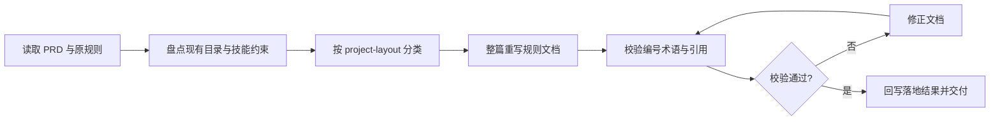

# 项目目录职责规则改写

## 目标与范围

把 [`project-folder-responsibility-description.md`](../general-rule/project-folder-responsibility-description.md) 从 FastAPI 分层目录规则改写为参照 [`golang-standards/project-layout`](https://github.com/golang-standards/project-layout) 的 Go 项目目录分类与职责规则，保持规则型结构与 `FOLDER-` 连续编号。

本次只改这一个文件。不移动、不新建任何项目目录，不改 Go 源码、构建配置与 `AGENTS.md`；该规则文件当前在 `AGENTS.md` 第 4 行处于注释状态，是否启用不在本次范围。

## 现状与关键决策

现状事实：

- 原文件共 19 条规则，内容围绕 `main.py`、`src/` 八层包、SQLAlchemy、Pydantic、Alembic 展开，并在开头链接已删除的 `fastapi-project-rules`。
- 项目实际顶层目录为 `cmd/`、`internal/`、`api/`、`configs/`、`db/`、`scripts/`、`hiduck/`、`.agents/`、`.claude/`、`.vscode/`，另有根级 `Makefile`、`Dockerfile`、`docker-compose.yml`、`.golangci.yml`、`sqlc.yaml`、`.air.toml`。
- [`go-web-project-rules`](../../.agents/skills/go-web-project-rules/SKILL.md) 已规定 `cmd/`、`internal/` 分层、`db/` 与分层依赖方向，并禁止 `pkg/`、`src/`、`models/`、`utils/`。本次文档只写目录级职责，不重复该技能中的分层编码细节。

关键决策：

- 文档开头把技能链接改为 `go-web-project-rules`；分层与依赖方向交由该技能约束，本文件只保留目录职责与目录级依赖边界。
- 采用“标准分类 + 项目状态”的写法：按 project-layout 列出 Go 工具链目录、工程配置与资源目录、项目扩展目录，并标注已采用、按需创建或不使用，避免为假想需求预建目录。
- `src/` 明确禁止；`pkg/` 本项目禁止，确需对外复用代码时先向用户确认，与 `go-web-project-rules` 第 8 条保持一致。
- `db/` 不是 project-layout 标准目录，作为项目扩展保留，存放 `migrations/` 与 `queries/`。
- `test/` 只放跨包共用的测试数据与外部测试程序；`*_test.go` 仍与被测代码同目录，遵循 `go-test-rules`。
- `Dockerfile` 与 `docker-compose.yml` 保留在根目录；`build/package/` 与 `deployments/` 只在出现多种打包产物或编排配置时创建。
- `docs/`、`assets/` 不另行创建，项目文档与资源分别归 `hiduck/doc/`、`hiduck/assets/`；`web/`、`init/`、`vendor/`、`tools/`、`examples/`、`third_party/`、`githooks/`、`website/` 当前不使用，需要时再建。
- 预计 34 至 38 条规则，编号全篇连续；章节为根目录与顶层分类、Go 工具链目录、工程配置与资源目录、项目扩展目录、文件命名与创建纪律、禁止目录。

## 实施任务

- [x] `rewrite-folder-rules` 整篇重写目录职责规则
  - 改动位置：[`hiduck/general-rule/project-folder-responsibility-description.md`](../general-rule/project-folder-responsibility-description.md)。
  - 实施动作：替换开头的 FastAPI 技能引用；按上述六个章节一次写全整篇；逐目录写明应放内容与边界；为 `cmd/<二进制名>`、`internal/<分层>`、`api/`、`configs/`、`scripts/`、`db/`、`build/`、`deployments/`、`test/`、`docs/`、`tools/`、`examples/`、`third_party/`、`web/`、`init/`、`vendor/`、`assets/`、`githooks/`、`website/` 给出归属判据；写入 Go 文件、SQL 文件、脚本与文档的命名规则；写明禁止目录与“不预建空目录”纪律。
  - 完成结果：文档内不再出现 FastAPI、Pydantic、SQLAlchemy、Alembic、`main.py` 等技术栈术语；所有目录职责能按 project-layout 分类判定；`FOLDER-` 编号从 1 连续到末条。
- [x] `validate-folder-rules` 校验并回写落地结果
  - 改动位置：同一规则文档，必要时修正表述。
  - 实施动作：检索旧技术栈术语与失效链接；核对 `FOLDER-` 编号连续性；核对文档引用的仓库路径真实存在，未采用目录标注为“按需创建”；在计划确认点前补充落地结果。
  - 依赖：`rewrite-folder-rules`。
  - 完成结果：校验项全部通过并在计划中记录实际校验范围；未通过项写明原因，不宣称完成。

## 流程图

## 验证方式

用户未要求测试，不编写、不执行测试。只做文档级轻量校验：检索旧技术栈术语、检查 `FOLDER-` 编号连续性、确认文档内链接与目录路径可解析；校验结果写入计划文档。

## 落地结果

[`project-folder-responsibility-description.md`](../general-rule/project-folder-responsibility-description.md) 已整篇重写，共 38 条规则，按根目录与顶层分类、Go 工具链目录、工程配置与资源目录、项目扩展目录、文件命名与目录创建、禁止目录六节组织。开头技能引用已改为 `go-web-project-rules`，`FOLDER-` 编号从 1 连续到 38。

已完成的校验：检索不到 FastAPI、Pydantic、SQLAlchemy、Alembic、`main.py` 与旧技能名；文档引用的 18 个目录与文件路径全部存在；未移动或新建任何项目目录。未编写、未执行测试。

## 计划落地确认点

- 实施范围：只重写 `hiduck/general-rule/project-folder-responsibility-description.md` 一份文档。
- 关键决策：采用 project-layout 全量分类但仅按需建目录；`pkg/` 与 `src/` 禁止；`db/`、`hiduck/`、`.agents/` 作为项目扩展目录；根级 `Dockerfile` 与 `docker-compose.yml` 不迁入 `build/` 或 `deployments/`。
- 完成判据：文档按 Go 技术栈与 project-layout 完成目录分类与职责说明，编号连续、无旧技术栈残留、引用路径有效。
- [x] 用户确认按本计划实施
