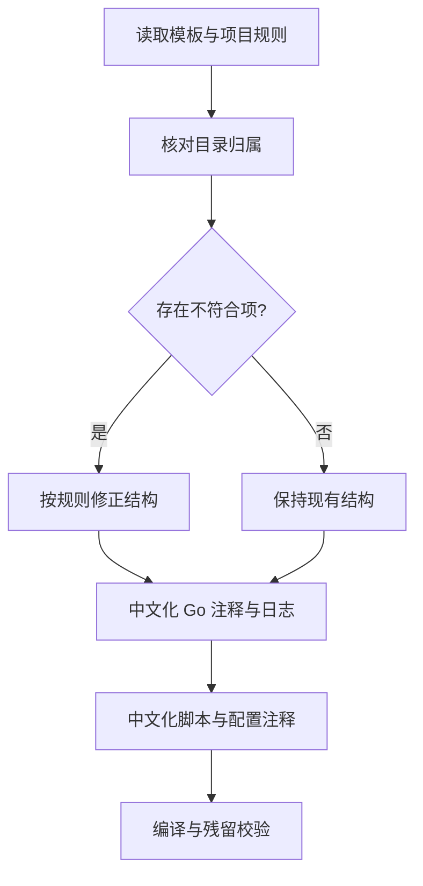

# 项目结构规范化与注释日志中文化

## 目标与范围

阅读 [`evrone/go-clean-template`](https://github.com/evrone/go-clean-template) 的分层与目录划分，以 [`project-folder-responsibility-description.md`](../general-rule/project-folder-responsibility-description.md) 和 [`go-web-project-rules`](../../.agents/skills/go-web-project-rules/SKILL.md) 为唯一规范，核对并修正当前离线本项目的目录结构与文件归属；同时把 Go 源码、脚本、SQL 与配置文件中注释和日志消息里的叙述性英文改写为简体中文。

本次不改动规则文档、测试用例语义、API 响应文案与 Go 错误串，不新增功能。用户未要求测试，不编写、不执行测试。

## 现状与关键决策

现状事实：

- 当前顶层结构为 `cmd/api/`、`internal/{domain,usecase,adapter,config,platform}/`、`db/{migrations,queries}/`、`api/`、`configs/`、`scripts/`、`bin/`、`hiduck/`、`.agents/`、`.claude/`、`.vscode/`，根级为 `go.mod`、`Makefile`、`README.md`、`Dockerfile`、`docker-compose.yml`、`sqlc.yaml`、`.air.toml`、`.golangci.yml`、`go-web-research-plan.md`。
- 模板与本项目的层次映射：`internal/entity` 对应 `internal/domain`；`internal/controller/restapi` 对应 `internal/adapter/http`；`internal/repo/persistent` 对应 `internal/adapter/postgres`；`internal/usecase` 对应 `internal/usecase`；`internal/app` 的组合根职责对应 `cmd/api/main.go` 的 `run()`；`migrations` 对应 `db/migrations`；`config` 对应 `internal/config` 与 `configs/`；`integration-test` 在需要时归 `test/`；`pkg/`、`nginx/` 不引入。
- 按上述规则核对，现有目录没有违反项：禁止目录 `pkg/`、`src/`、`models/`、`utils/` 均不存在，`internal/` 分层与 `.golangci.yml` 的 depguard 白名单一致，`cmd/api/` 只放组合根，`db/migrations/migrate.go` 是规则允许的迁移执行代码。
- 现有 Go 源码注释、日志消息与部分脚本配置注释为英文；按描述性注释与日志调用粗略统计，待改写文本约 91 行注释、16 处日志调用，不含 `internal/adapter/postgres/sqlc/` 生成代码与机器指令。

关键决策：

- 结构以本项目规则为准，模板只作为层次划分的对照参照；模板的 `internal/controller`、`internal/entity`、`internal/repo`、`pkg/` 命名不迁入本项目。
- 结构核对若未发现不符合项，则不移动、不新建任何目录；确有不符项时只做规则允许的归属调整，并同步更新 `README.md` 的目录结构说明。
- 中文化只处理叙述性文字：保留标识符、类型名、包名、库名、命令、配置键、日志字段键、HTTP 路径与状态码、`slog` 字段值、Go 错误串与 API 响应文案的原文。
- `internal/adapter/postgres/sqlc/*.go` 由 sqlc 生成，禁止手工修改；`// +goose Up/Down`、`-- name:`、`//go:embed`、`// shellcheck` 等机器指令保持原样。

## 实施任务

- [x] `audit-structure` 对照模板核对目录结构并修正不符合项
  - 改动位置：仓库顶层目录、`internal/` 各层、`README.md`。
  - 实施动作：按模板层次逐项核对本项目的目录归属，确认 `cmd/`、`internal/`、`db/`、`api/`、`configs/`、`scripts/` 的职责与规则一致；发现未归位文件时按 `FOLDER-*` 与 `go-web-project-rules` 修正，并同步 `README.md` 的目录树；未发现不符合项时保持现状。
  - 完成结果：模板每个层次都有明确的本项目落点或“不采用”结论；仓库内不存在禁止目录与未归位文件；`README.md` 与实际结构一致。

- [x] `localize-go-comments-logs` 中文化 Go 源码注释与日志消息
  - 改动位置：`cmd/api/main.go`、`internal/domain/{errors,notebook,repository}.go`、`internal/usecase/{notebook.go,notebook_test.go}`、`internal/adapter/http/{dto,errors,middleware,notebook,notebook_test,router}.go`、`internal/adapter/postgres/{db,notebook,notebook_test}.go`、`internal/config/config.go`、`internal/platform/logger/logger.go`、`internal/platform/server/server.go`、`db/migrations/migrate.go`。
  - 实施动作：把注释中的叙述性英文改写为中文，示例用反引号保留技术名词；把 `slog` 的 `Info`、`Warn`、`Error` 消息文本改写为中文，字段键与字段值保持原文，如 `notebook_id`、`request_id`、`duration_ms`。跳过 `internal/adapter/postgres/sqlc/` 生成代码与所有机器指令；不改 `fmt.Errorf` 错误串、`t.Fatalf` 断言文本与 HTTP 响应文案。
  - 依赖：`audit-structure`。
  - 完成结果：上述文件注释均为中文叙述，日志消息为中文，技术标识符与字段键保持原文，代码可正常编译。

- [x] `localize-aux-comments` 中文化脚本、SQL 与配置中的描述性注释
  - 改动位置：`scripts/dev.sh`、`scripts/migrate.sh`、`docker-compose.yml`、`configs/.env.example`、`.golangci.yml`、`api/requests.http`。
  - 实施动作：把 `scripts/*.sh` 的说明注释、`docker-compose.yml` 与 `configs/.env.example` 的解释注释、`.golangci.yml` 中描述分层约束的注释、`api/requests.http` 的请求标题改写为中文；`#!/usr/bin/env bash`、`# shellcheck`、`-- +goose`、`-- name:` 等机器指令保持原文；`db/migrations/*.sql` 与 `db/queries/*.sql` 除机器指令外没有描述性注释，不处理。
  - 依赖：`audit-structure`。
  - 完成结果：脚本与配置中的说明文字为中文，机器指令与配置键保持原文，脚本执行逻辑未变。

- [x] `validate-localization` 执行校验并回写落地结果
  - 改动位置：本次改动的全部文件与计划文档。
  - 实施动作：对改动过的 Go 文件运行 `gofmt -l`，对全项目运行 `go build ./...`；检索 Go 与脚本配置文件中残留的英文叙述性注释和日志消息；用 `git diff --stat` 确认 `internal/adapter/postgres/sqlc/` 未被改动；在确认点前补充简短落地结果。
  - 依赖：`localize-go-comments-logs`、`localize-aux-comments`。
  - 完成结果：格式检查无输出、编译通过、无遗漏的英文叙述性文本、生成代码零改动；校验结果如实记录，未执行测试并写明。

## 流程图

## 验证方式

用户未要求测试，不编写、不执行测试。只做轻量校验：`gofmt -l` 检查改动文件、`go build ./...` 编译全项目、检索残留英文叙述性注释与日志文本、核对生成代码无改动；校验结果写入计划文档。

## 落地结果

结构核对完成：模板的 `internal/entity`、`internal/controller`、`internal/repo`、`internal/app` 分别对应本项目的 `internal/domain`、`internal/adapter/http`、`internal/adapter/postgres` 与 `cmd/api` 组合根，`pkg/`、`nginx/` 不采用；仓库顶层目录与 `internal/` 分层符合项目规则，未移动或新建任何目录，`README.md` 无需调整。

注释与日志中文化完成：18 个 Go 源文件的注释改为中文，13 处 `slog` 日志消息改为中文并保留字段键；`scripts/dev.sh`、`docker-compose.yml`、`configs/.env.example`、`.golangci.yml`、`api/requests.http` 的描述性注释同样改为中文。sqlc 生成代码、机器指令、Go 错误串、测试断言与 API 响应文案保持原样。

校验结果：`gofmt -l cmd internal db` 无输出，`go build ./...` 通过，`internal/adapter/postgres/sqlc/` 无改动，残留英文注释与日志消息检索无结果。未编写、未执行测试。

## 计划落地确认点

- 实施范围：核对并修正本项目目录结构与归属，中文化 Go 源码、脚本、SQL 与配置中的注释及日志消息。
- 关键决策：以本项目目录规则为准，`evrone/go-clean-template` 仅作分层参照；结构核对无不符合项时不迁移目录；生成代码、机器指令、Go 错误串与 API 响应文案不翻译。
- 完成判据：模板层次均有对应结论或保留项，仓库结构与规则一致；注释与日志中的叙述性英文改为中文且技术标识符保持原文；`gofmt -l` 无输出且 `go build ./...` 通过。
- [x] 用户确认按本计划实施
